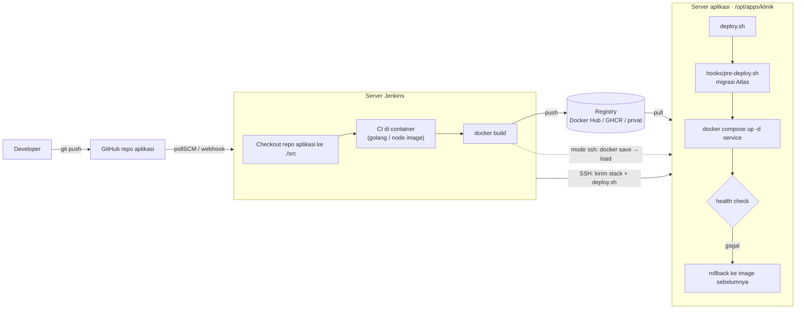

# Jenkins CI/CD — pipeline generik untuk banyak repository

Satu `Jenkinsfile` + satu set playbook Ansible untuk build dan deploy repository aplikasi ke
server memakai Docker Compose. Saat ini sudah dikonfigurasi untuk:

| Project | Repo | Isi | Hasil |
|---|---|---|---|
| `klinik-api` | [gigihpra/klinik-api](https://github.com/gigihpra/klinik-api) | Go 1.24 + PostgreSQL (migrasi Atlas) | image `klinik-api` → service `api` |
| `klinik-app` | [gigihpra/klinik-app](https://github.com/gigihpra/klinik-app) | Vue 3 + Vite | image `klinik-app` (nginx) → service `web` |

Repository lain cukup ditambahkan lewat satu file YAML di `projects/` (lihat
[Menambah repository baru](#menambah-repository-baru)).

## Arsitektur



Jenkins dan server aplikasi boleh **satu mesin** atau **terpisah**. Jenkins tidak perlu Go/Node —
semua langkah test/build berjalan di container, jadi satu server Jenkins bisa melayani repo dengan
bahasa apa pun.

Stack `klinik` di server:

```
web  (nginx, :80) ──/api, /files──▶ api (Go, :8080) ──▶ db (PostgreSQL 17, volume pgdata)
                                     └─ volume uploads
migrate (Atlas, profile "tools") — dijalankan otomatis tiap deploy api
```

## Struktur repository

```text
.
├── Jenkinsfile                   # pipeline generik (dipakai semua job)
├── projects/
│   ├── _defaults.yml             # default semua project (registry, credential, server)
│   ├── _template.yml             # contoh lengkap semua opsi
│   ├── klinik-api.yml
│   └── klinik-app.yml
├── templates/                    # Dockerfile untuk repo yang belum punya Dockerfile
│   ├── vue-spa/                  #   Node build → nginx (SPA + proxy /api)
│   └── go-service/               #   binary Go statis di alpine
├── deploy/
│   ├── deploy.sh                 # skrip deploy generik di server (lock, health check, rollback)
│   └── stacks/
│       ├── klinik/               # docker-compose.yml, .env.example, hooks/pre-deploy.sh
│       └── _example/
└── ansible/
    ├── ansible.cfg
    ├── inventory/
    │   ├── hosts.ini.example
    │   └── group_vars/           # all.yml, jenkins.yml, app_servers.yml
    ├── playbooks/                # site.yml, jenkins.yml, app-servers.yml
    └── roles/                    # common, docker, jenkins, app
```

## 1. Siapkan server dengan Ansible

Ansible dijalankan dari Linux / WSL / macOS (Ansible tidak bisa jadi controller di Windows native).
Server target: **Ubuntu 22.04/24.04 atau Debian 12**.

```bash
cd ansible
cp inventory/hosts.ini.example inventory/hosts.ini   # isi IP & user server
ansible all -m ping
ansible-playbook playbooks/site.yml                  # tambah -K bila sudo pakai password
```

Yang dilakukan — **setiap komponen dicek dulu, yang sudah terpasang dilewati**:

| Role | Host | Isi | Dilewati bila |
|---|---|---|---|
| `common` | semua | ca-certificates, curl, git, jq, acl, util-linux, … + timezone | paket sudah ada (hanya paket yang kurang yang di-install, `apt update` tidak dijalankan bila lengkap) |
| `docker` | semua | Docker Engine, Compose plugin, Buildx, rotasi log | `docker` sudah ada → engine tidak disentuh; hanya plugin yang kurang yang dilengkapi (sesuai sumber: `docker-ce` atau `docker.io`) |
| `jenkins` | `[jenkins]` | Java 21, Jenkins LTS, plugin, user jenkins di grup docker, SSH key deploy | Java ≥ 21 sudah ada; `jenkins.war` sudah ada; plugin sudah ada di `$JENKINS_HOME/plugins` |
| `app` | `[app_servers]` | user deploy di grup docker, public key Jenkins di `authorized_keys`, `/opt/apps/<stack>/`, file `.env` | `.env` sudah ada → **tidak ditimpa** (kecuali `app_env_overwrite=true`) |

Secret `.env` (`POSTGRES_PASSWORD`, `JWT_SECRET`) dibuat acak sekali dan disimpan di
`ansible/credentials/<host>/` (di-gitignore). Simpan folder ini di tempat aman. Kalau Anda lebih
suka ansible-vault, ganti nilainya di `inventory/group_vars/app_servers.yml`.

Variabel yang sering diubah:

| File | Variabel | Default |
|---|---|---|
| `group_vars/all.yml` | `docker_install_method` | `official` (repo download.docker.com); `distro` = paket Ubuntu |
| `group_vars/jenkins.yml` | `jenkins_http_port`, `jenkins_plugins` | `8080` |
| `group_vars/app_servers.yml` | `app_base_dir`, `app_stacks[].env` | `/opt/apps` |

Di akhir playbook Jenkins, password admin awal dan lokasi private key deploy ditampilkan.

## 2. Konfigurasi Jenkins

1. Buka `http://<server-jenkins>:8080`, masukkan password admin awal. Plugin yang dibutuhkan sudah
   di-install Ansible, jadi di wizard pilih **Select plugins to install → None**.
2. **Manage Jenkins → Credentials → System → Global** — buat:

| ID | Jenis | Isi |
|---|---|---|
| `github-credentials` | Username with password | username GitHub + Personal Access Token (read repo). Hapus/kosongkan `git_credentials` di config bila repo publik |
| `dockerhub-credentials` | Username with password | username Docker Hub + access token |
| `app-server-ssh` | SSH Username with private key | user deploy (mis. `ubuntu`) + isi `sudo cat /var/lib/jenkins/.ssh/id_ed25519` |
| `app-server-host` | Secret text | IP/hostname server aplikasi |

3. Buat repo image di Docker Hub: `klinik-api` dan `klinik-app` (private disarankan).
4. Buat job **Pipeline** per project — **nama job = nama file di `projects/`**:
   - New Item → nama `klinik-api` → Pipeline
   - Definition: *Pipeline script from SCM* → Git → `https://github.com/gigihpra/jenkin-ci-cd.git`,
     branch `*/master` (sesuaikan), Script Path `Jenkinsfile`
   - Ulangi untuk `klinik-app` (bisa *Copy from* `klinik-api`).
5. Jalankan **Build Now** sekali. Build pertama mendaftarkan parameter & trigger polling.

Parameter build (Build with Parameters):

| Parameter | Fungsi |
|---|---|
| `PROJECT` | nama config di `projects/` (default nama job) |
| `BRANCH` | override branch / tag / commit SHA (kosong = `branch` di config) |
| `RUN_CI` | jalankan `ci.steps` |
| `DEPLOY` | deploy setelah build (matikan untuk build-only) |

> Trigger `pollSCM` juga memantau repo `jenkin-ci-cd` ini, jadi commit ke repo ini memicu build
> semua job. Bila tidak diinginkan, isi *Additional Behaviours → Polling ignores commits in certain
> paths* di job, atau pakai webhook GitHub.

## 3. Deploy pertama (stack klinik)

1. Jalankan job `klinik-api` → image dibangun, dikirim, `db` dinyalakan, migrasi Atlas dijalankan,
   lalu `api` dicek lewat `/healthz`.
2. Jalankan job `klinik-app` → `web` (nginx) jalan di port 80.
3. **Sekali saja** untuk database baru, isi data awal (admin / admin12345):

```bash
ssh ubuntu@<server-app>
cd /opt/apps/klinik
docker compose exec -T db psql -U klinik -d klinik -v ON_ERROR_STOP=1 < db/seed/seed.sql
# opsional, contoh master IGD/ICU/ranap:
docker compose exec -T db psql -U klinik -d klinik -v ON_ERROR_STOP=1 < db/seed/seed_igd_ranap.sql
```

Segera ganti password admin setelah login. Folder `db/` di server diekstrak otomatis dari image API
pada setiap deploy (berisi `migrations/` + `seed/`).

Setelah memakai domain + HTTPS (mis. Caddy/Traefik/nginx di depan), ubah di
`/opt/apps/klinik/.env`: `CORS_ORIGINS=https://domain-anda`, `COOKIE_SECURE=true`, dan bila perlu
`WEB_BIND=127.0.0.1` + `WEB_PORT=8081`; lalu `docker compose up -d`.

## Menambah repository baru

1. Salin `projects/_template.yml` → `projects/<nama-job>.yml`, isi `repo`, `image.name`, `ci.steps`,
   `build` (Dockerfile milik repo **atau** `template: vue-spa` / `go-service`), dan `deploy`.
2. Buat stack di `deploy/stacks/<stack>/docker-compose.yml` (lihat `_example/`). Image service
   ditulis sebagai `${<IMAGE_VAR>:-nama:not-deployed}` — `deploy.sh` yang mengisinya.
   Butuh langkah sebelum start (migrasi, dsb.)? Tambahkan `hooks/pre-deploy.sh`.
3. Tambahkan stack ke `app_stacks` di `ansible/inventory/group_vars/app_servers.yml` (untuk `.env`),
   jalankan `ansible-playbook playbooks/app-servers.yml`.
4. Buat job Jenkins dengan nama yang sama → Build.

Beberapa service boleh berbagi satu stack (seperti `api` + `web` di `klinik`); `deploy.sh` memakai
lock sehingga dua job tidak saling menimpa `.env`.

### Referensi config project

| Key | Keterangan |
|---|---|
| `repo`, `branch`, `git_credentials` | sumber kode |
| `ci.image`, `ci.workdir`, `ci.env`, `ci.steps[]` | step CI; tiap step: `name`, `run`, opsional `image`, `workdir`, `env`. `image: ""` = jalan langsung di host Jenkins. Cache Go/npm/pip disimpan di `$JENKINS_HOME/ci-cache/<project>` |
| `image.name` | nama image |
| `build.dockerfile` / `build.template` | Dockerfile repo atau template dari `templates/` |
| `build.context`, `build.args`, `build.target`, `build.platform` | opsi `docker build` |
| `build.env_file`, `build.env` | tulis variabel build-time (mis. `VITE_*`) ke file sebelum build |
| `registry.mode` | `registry` (push/pull) atau `ssh` (tanpa registry, image di-stream lewat SSH) |
| `registry.url`, `registry.namespace`, `registry.credentials`, `registry.push_latest` | registry tujuan |
| `deploy.stack`, `deploy.service`, `deploy.image_var` | target di server |
| `deploy.host` / `deploy.host_credentials`, `deploy.ssh_credentials`, `deploy.ssh_port`, `deploy.base_dir` | koneksi server |
| `deploy.health.cmd`, `.retries`, `.interval` | health check (dijalankan di folder stack; fungsi `compose` tersedia) |
| `deploy.rollback` | kembalikan image sebelumnya bila gagal (default `true`) |

Deploy ke server lain cukup override `deploy.host_credentials` / `deploy.ssh_credentials` di file
project (mis. buat `klinik-api-staging.yml` dengan `branch: develop` dan host staging).

## Operasional

```bash
cd /opt/apps/klinik
docker compose ps
docker compose logs -f api
cat .release/history.log                         # riwayat deploy (OK / FAIL, image, commit)

# rollback manual ke image tertentu
IMAGE=docker.io/<user>/klinik-api:41-abcd1234 ./deploy.sh api

# backup database
docker compose exec -T db pg_dump -U klinik -Fc klinik > backup-$(date +%F).dump
```

Tag image: `<BUILD_NUMBER>-<8 karakter commit>`, jadi setiap image bisa ditelusuri ke commit-nya.

## Troubleshooting

| Gejala | Penyebab / solusi |
|---|---|
| `permission denied ... docker.sock` di Jenkins | user jenkins belum di grup docker → jalankan ulang playbook (Jenkins di-restart otomatis) |
| `Konfigurasi projects/<x>.yml tidak ditemukan` | nama job ≠ nama file; isi parameter `PROJECT` atau ganti nama job |
| `No such DSL method 'readYaml'` | plugin *Pipeline Utility Steps* belum terpasang |
| SSH `Permission denied (publickey)` | public key jenkins belum ada di server app → `ansible-playbook playbooks/app-servers.yml`; cek credential `app-server-ssh` |
| `.env belum ada` saat deploy | jalankan playbook app-servers atau salin `deploy/stacks/<stack>/.env.example` |
| apt Jenkins `NO_PUBKEY` | kunci repo Jenkins berganti → perbarui `jenkins_repo_key_url` |
| Migrasi Atlas gagal pada database lama (hasil import) | database belum punya tabel revisi Atlas; lakukan baseline (`atlas migrate apply --baseline <versi>`) secara manual sekali |
| Upload file gagal (permission) | hook pre-deploy sudah men-`chown` volume `uploads` ke uid 10001; cek `docker compose logs api` |
